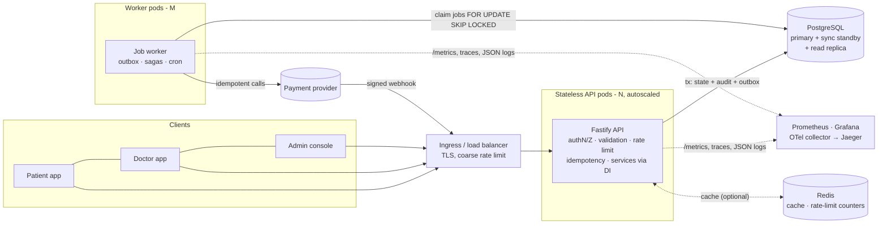
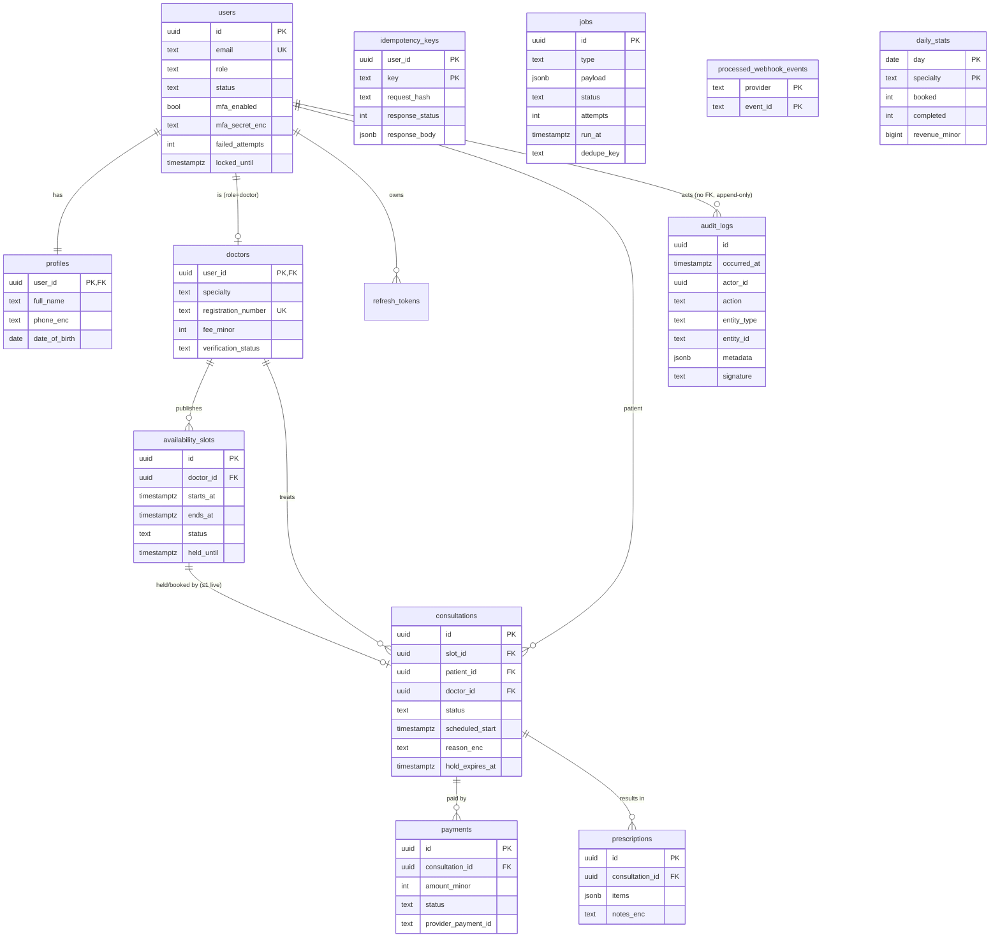

# Architecture

Amrutam telemedicine backend — design, data flow and the reasoning behind the main decisions.
Targets: **100k consultations/day**, **p95 < 200 ms reads / < 500 ms writes**, **99.95 % availability**.

## 1. High-level architecture & data flow



**Why this shape**

| Decision | Reasoning |
|---|---|
| Modular monolith, not microservices | One team, one transactional domain (slot ↔ consultation ↔ payment). Splitting it would turn local ACID transactions into distributed ones for no scaling benefit. Module boundaries (`modules/*`) and constructor-injected ports (`PaymentProvider`, `Notifier`, `Cache`, `Clock`, `Db`) keep extraction possible later. |
| PostgreSQL as the source of truth *and* the queue | The booking invariant ("a slot has at most one live consultation") is enforced by the database. Putting the job queue in the same DB gives a **transactional outbox for free**: a job exists iff the business change committed. At this scale (≈ tens of jobs/s) a dedicated broker adds failure modes without adding capacity. |
| Redis is optional | It only holds cache entries and rate-limit counters. Losing it degrades to "always miss"/per-pod limits; correctness never depends on it (`ResilientCache`). |
| Stateless API + separate worker | API pods scale on CPU and are safe to kill any time. The worker scales on queue depth. Heavy work (analytics rollups, PSP calls, notifications) never runs on the request path. |
| Metrics on a separate port | `/metrics` is never reachable through the public ingress. |

**Capacity sketch.** 100k consultations/day ≈ 1.2 bookings/s average, ~12/s at a 10× peak. Each consultation drives roughly 25 API calls (search, slot polling, payment polling, lifecycle) → ≈ 35 req/s average, ≈ 350 req/s peak. One API pod measured 18 k req/s on cached reads and ≈ 25 ms p95 on writes on a laptop with the load generator on the same machine (see `npm run loadtest`) — so the headroom is large and HA, not throughput, drives the replica count (4 pods across 3 AZs, `minAvailable: 3`). The first real bottleneck will be Postgres write IOPS from audit rows (~10 per consultation), which is why `audit_logs` is partitioned from day one.

## 2. Booking flow (sequence)

The booking is a **saga with a local transaction at each step**; money movement is the only step that is not under our control, so it is modelled as an event.

```mermaid
sequenceDiagram
  autonumber
  participant C as Patient
  participant API as API
  participant DB as PostgreSQL
  participant W as Worker
  participant PSP as Payment provider

  C->>API: POST /v1/consultations {slotId}<br/>Idempotency-Key: K
  API->>DB: BEGIN
  API->>DB: INSERT idempotency_keys (K) — blocks duplicates
  API->>DB: UPDATE slot SET held WHERE open (atomic claim)
  alt slot lost the race
    DB-->>API: 0 rows
    API-->>C: 409 SLOT_UNAVAILABLE (tx rolled back, K not stored)
  else slot claimed
    API->>DB: INSERT consultation(pending_payment, hold_expires_at)
    API->>DB: INSERT payment(pending) + job(payment.create_intent) + audit_log
    API->>DB: store response under K; COMMIT
    API-->>C: 201 {status: pending_payment, payment}
  end

  W->>DB: claim job (SKIP LOCKED)
  W->>PSP: createIntent(idempotencyKey = paymentId)
  W->>DB: payment.checkout_url = …
  C->>API: GET /v1/payments/:id → checkoutUrl
  C->>PSP: pays

  PSP->>API: POST /v1/payments/webhook (HMAC-signed, event id E)
  API->>DB: BEGIN; INSERT processed_webhook_events(E) — dedupe
  API->>DB: lock consultation → payment → slot
  alt consultation still pending_payment
    API->>DB: payment=succeeded, consultation=confirmed, slot=booked, jobs(notify×2)
  else already expired / cancelled
    API->>DB: payment=refund_pending + job(payment.refund)  (compensation)
  end
  API->>DB: COMMIT

  Note over W,DB: Cron expire_holds every 30 s: pending_payment past hold_expires_at →<br/>consultation=expired, payment=failed, slot=open (compensation for abandoned checkout)
```

Edge cases covered by tests (`tests/booking.test.ts`): concurrent bookings of one slot (exactly one wins), retried requests with the same key, a different payload under a reused key (422), hold expiry, booking over an expired hold before the sweeper runs, payment succeeding after expiry or cancellation (automatic refund), duplicate/replayed/forged webhooks, PSP outage with backoff, dead-lettering, worker crash mid-job (lease expiry).

## 3. ER diagram



Core tables required by the brief — `users, profiles, doctors, availability_slots, consultations, prescriptions, payments, audit_logs` — plus operational tables (`refresh_tokens`, `idempotency_keys`, `jobs`, `processed_webhook_events`, `daily_stats`). Schema: `migrations/001_init.sql`, `002_audit_logs.sql`.

Invariants enforced **in the database**, not just in code:

* `consultations_live_slot_uq` — partial unique index: at most one non-cancelled/expired consultation per slot (last line of defence against double booking).
* `slots_doctor_start_uq` — a doctor can't have two slots starting at the same instant; overlap across different slot lengths is prevented under a per-doctor row lock.
* `CHECK ((status='held') = (held_until IS NOT NULL))` on slots.
* Trigger blocks `UPDATE`/`DELETE` on `audit_logs`.
* Money is integer minor units (paise) — no floating-point.

## 4. API schema

`openapi/openapi.yaml` (OpenAPI 3.1, 35 operations). `tests/openapi.test.ts` fails CI if a route exists in code but not in the spec or vice-versa. Conventions: JSON only; `Idempotency-Key` on booking and prescriptions; opaque keyset cursors; uniform `{ error: { code, message, details?, requestId } }` envelope; `x-request-id` on every response; strict request schemas (unknown fields → 400, which also blocks mass-assignment).

## 5. Retry & backoff strategies

| Where | Strategy |
|---|---|
| **Background jobs** (`jobs/queue.ts`) | Failures re-queue with **full-jitter exponential backoff**: `delay = rand(0, min(30 min, 5 s · 2^attempt))`, max 8 attempts, then status `dead` (alert `JobsDeadLettered`, manual replay by resetting `status='queued'`). Jitter prevents synchronized retry storms after a PSP outage. |
| **Worker crash** | Claimed jobs carry a 60 s lease (`locked_until`); an expired lease makes the job claimable again, so at-least-once delivery holds. Handlers are idempotent (they re-check state first and use provider idempotency keys). |
| **Serialization failures / deadlocks** | `Db.tx` retries the whole transaction on SQLSTATE `40001`/`40P01` up to 4× with 20–400 ms jittered backoff. |
| **PSP calls** | 8 s timeout per call; retried by the job layer, never inline on the request path. `createIntent`/`refund` send our payment id as the provider idempotency key. |
| **Inbound webhooks** | We return non-2xx for transient problems (unknown payment → 404) so the PSP's own retry schedule applies; duplicates are absorbed by `processed_webhook_events`. |
| **Clients** | Safe to retry any write that carries an `Idempotency-Key`; replays return the original response with `Idempotent-Replayed: true`. Rate-limited calls return `429` + `Retry-After`. |

`lib/retry.ts` (`backoffDelay`, `retry`) is unit-tested, including the jitter bounds.

## 6. Data partitioning & growth

* **`audit_logs`** — `PARTITION BY RANGE (occurred_at)`, monthly. A `maintenance.cleanup` cron creates partitions 3 months ahead (a `DEFAULT` partition catches stragglers, so a missed run never loses data). Old partitions can be detached and exported to object storage (e.g. > 13 months) without touching the hot table. No FKs point at it, which is what makes this cheap. ≈ 10 rows per consultation ⇒ ~1 M rows/day ⇒ ~30 M per partition.
* **`consultations` / `payments` / `prescriptions`** — ~36 M rows/year at target volume; comfortably handled by the existing indexes (`patient_id, scheduled_start DESC`, `doctor_id, scheduled_start DESC`, partial indexes on hold expiry). **Planned** (not yet implemented, intentionally): range-partition `consultations` by `scheduled_start` once the table passes ~150–200 M rows. That requires the live-slot uniqueness to move onto the slot row (e.g. `availability_slots.consultation_id UNIQUE`) because unique indexes on partitioned tables must include the partition key — the migration path is documented here so it isn't a surprise.
* **`availability_slots`** — only future/near-past slots are hot; a nightly job can delete `open` slots older than 30 days.
* **Scale-out path:** add a streaming read replica and route `GET /v1/consultations`, search and analytics to it (read-your-writes callers stay on the primary); later shard by `doctor_id` hash if a single primary ever becomes the limit.
* **Hot-row note:** popular doctors concentrate bookings on a few `availability_slots` rows. The claim is a single-row `UPDATE … WHERE status='open'`, so contention is row-level and short; no table or doctor-level lock is taken on the booking path.

## 7. Caching & concurrency handling

**Caching** (`lib/cache.ts`; Redis when `REDIS_URL` is set, in-process otherwise)

| Data | TTL | Invalidation | Notes |
|---|---|---|---|
| Doctor search results | 30 s | version bump on profile/verification change | availability-filtered results may be ≤ 30 s stale; booking re-checks the DB, so staleness can only cause a clean 409, never a double booking |
| Doctor profile | 30 s | same version | |
| Doctor slot list | 5 s | per-doctor version bumped on publish / book / cancel / expiry | |

* **Single-flight** (`ReadThrough`): concurrent misses for one key trigger one DB query (stampede protection).
* **Versioned keys** instead of key deletion: bumping `ver:<family>` invalidates a whole family atomically without scanning.
* **Never cached:** anything on the write path, PHI (consultation reasons, prescriptions), auth state.
* Redis failure ⇒ `ResilientCache` returns misses and logs; the API stays up.

**Concurrency control** — layered, cheapest first:

1. **Atomic conditional UPDATE** claims a slot (`open → held`); exactly one transaction matches.
2. **Partial unique index** on live consultations backs it up if code ever regresses.
3. **Idempotency** serializes retries of the same request on the `(user_id, key)` unique index.
4. **Consistent lock order** `consultation → payment → slot` in booking, webhook, cancel and expiry paths avoids deadlocks; `Db.tx` retries the rare one that still occurs.
5. **`FOR UPDATE SKIP LOCKED`** lets any number of workers pull jobs and sweep expired holds in parallel without blocking.
6. **Per-doctor row lock** (`SELECT … FOR UPDATE` on `doctors`) serializes slot publishing so overlap checks can't race.
7. **Hold caps:** ≤ 3 unpaid holds per patient (prevents calendar-sweeping DoS); overlapping bookings for the same patient are rejected.

Isolation level is READ COMMITTED; every invariant is guarded by a constraint or a single atomic statement rather than by relying on SERIALIZABLE.

## 8. Transaction management & sagas

* **Unit of work:** `Db.tx(fn)` — all writes inside go through the supplied `q`; external effects (cache bump, HTTP) happen after commit.
* **Audit in the same transaction** as the change it describes: no "changed but unlogged" window.
* **Transactional outbox:** side effects (create payment intent, refund, notifications) are `INSERT INTO jobs` in the business transaction and executed later by the worker.
* **Idempotency record in the same transaction** as the work, so a crash leaves nothing and a concurrent duplicate simply waits and replays (no "in progress" state to get stuck).
* **Saga steps & compensations**

| Step | Action | Compensation |
|---|---|---|
| 1 | Hold slot + create consultation & payment (local tx) | Hold expiry sweeper / cancel → slot reopened, payment failed |
| 2 | Create PSP intent (async job) | Retries with backoff; skipped if the booking died meanwhile |
| 3 | Payment webhook → confirm | Late success on a dead booking → automatic refund |
| 4 | Cancel after confirmation | Refund job (policy: doctor/admin always; patient ≥ 24 h ahead) |

* **State machine:** `pending_payment → confirmed → in_progress → completed`, with `cancelled | expired | no_show` exits. Every status write passes through `transition()` which checks the legal-moves table (`TRANSITIONS`).

## 9. Backup & disaster recovery

| | Target | How |
|---|---|---|
| **RPO** | ≤ 5 min (≈ 0 for AZ loss) | Managed Postgres (e.g. RDS/Cloud SQL) Multi-AZ with **synchronous standby**, continuous WAL archiving → **point-in-time recovery** to any second in the last 35 days. |
| **RTO** | ≤ 30 min AZ failure (automatic failover ≈ 1–2 min); ≤ 2 h region loss | Cross-region read replica / replicated snapshots; promote + repoint secrets. App tier is stateless and redeployable from the image + manifests in minutes. |
| **Logical backup** | daily, 30-day retention, encrypted (KMS), stored in a second account/region with object-lock | `pg_dump --format=custom` (see `scripts/restore-drill.sh`). Protects against operator error and logical corruption that PITR would faithfully replay. |
| **Audit archive** | detached monthly partitions exported to WORM storage | Meets retention/compliance without bloating the hot DB. |
| **Redis** | none | Disposable by design. |
| **Secrets / keys** | KMS-backed secret manager with versioning; data keys exist in ≥ 2 regions | Losing the data keys = losing PHI, so they are backed up separately from the database. |

**Restore drill (monthly + after schema changes):** restore the latest backup into a scratch DB and run `scripts/restore-drill.sh`, which also checks saga invariants (no slot with two live consultations, no confirmed consultation on an unbooked slot). A backup that has never been restored is not a backup.

**Failure runbook (short):**
1. *API pods unhealthy* → readiness fails, traffic drains; roll back with `kubectl rollout undo`.
2. *DB primary lost* → managed failover; pods reconnect via the pool (idle-client errors are swallowed, new connections succeed). Watch `DbPoolSaturated`.
3. *PSP outage* → bookings still succeed (holds); payment jobs back off and drain after recovery. Hold time (10 min) bounds slot blocking.
4. *Dead jobs* → `SELECT type, last_error FROM jobs WHERE status='dead'`; fix cause; `UPDATE jobs SET status='queued', attempts=0, run_at=now() WHERE …`.
5. *Bad migration* → migrations are additive (expand/contract) so the previous app version keeps working; roll back the app, not the schema.

## Deployment

`docker compose up --build` for local; `deploy/k8s/` for Kubernetes (Deployments, HPA, PDB, NetworkPolicies, ExternalSecret, ingress, migration Job). CI (`.github/workflows/ci.yml`): typecheck → build → tests on real Postgres and PGlite → `npm audit` → gitleaks → CodeQL → image build → Trivy → push (SHA-tagged) → manual-approval deploy: migrate Job, rolling update with `maxUnavailable: 0`, auto-rollback on failure.

## Known limitations / next steps

* Payment provider is a mock behind the `PaymentProvider` port; a real adapter must map the PSP's event schema to `{id, type, data.paymentId}` and use its signature scheme.
* Video/chat delivery is out of scope (no media plane); `start`/`complete` model the clinical session lifecycle only.
* Access tokens are stateless: a suspended user's existing access token works until it expires (≤ 15 min); refresh is blocked immediately.
* MFA has no recovery codes yet; account recovery is an admin-assisted process.
* `consultations` partitioning and the read-replica routing are designed (above) but not implemented.
* Rate limiting keys on client IP; per-user limits would be a straightforward extension.
